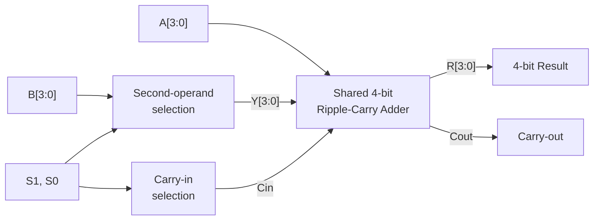
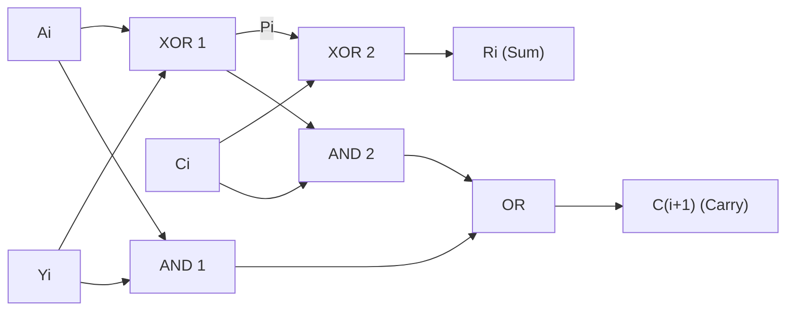
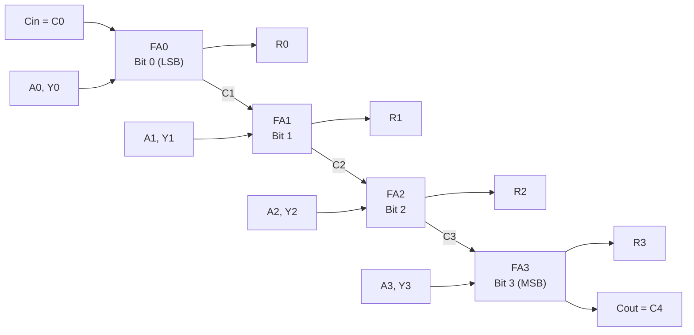
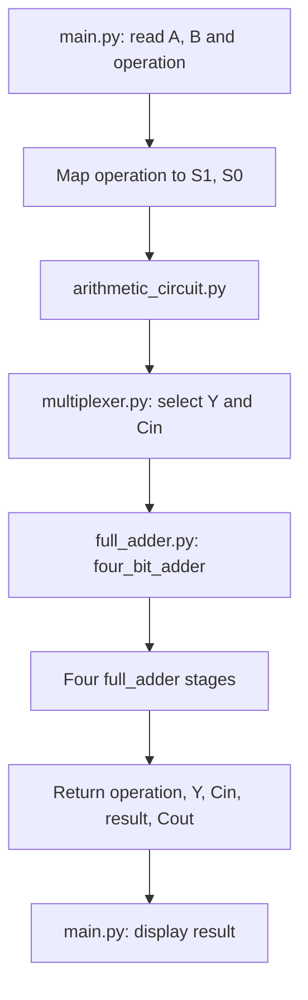

# 4-Bit Arithmetic Circuit Simulator

A Computer Organization and Architecture (COA) mini-project that demonstrates how **one shared 4-bit ripple-carry adder** can perform four arithmetic operations—addition, subtraction, increment, and decrement—by changing only its selected second operand and initial carry input.

The project contains:
- a Python implementation of the arithmetic circuit;
- a command-line interface;
- a browser-based interactive simulator;
- a gate-level circuit visualization with live signal values; and
- an automated test program covering 1,024 input/operation combinations.

> **Core idea:** the adder itself is not replaced for each operation. The same four cascaded full-adder stages are reused. The control inputs `S1` and `S0` select the value sent to the adder as `Y` and select its initial carry `Cin`.

---

## 1. Notation and symbols

The notation used in the explanations and diagrams is defined here before it is used.

| Symbol | Meaning |
|---|---|
| `A` | First 4-bit operand, `A3 A2 A1 A0` |
| `B` | Second 4-bit operand, `B3 B2 B1 B0` |
| `S1`, `S0` | Two operation-selection control bits |
| `Y` | 4-bit value selected as the second input to the adder |
| `Cin` | Initial carry input supplied to the least-significant full adder |
| `C0` | Carry entering bit 0; therefore `C0 = Cin` |
| `Ci` | Carry entering bit position `i` |
| `C(i+1)` | Carry leaving bit position `i` and entering the next stage |
| `Cout` | Final carry leaving the most-significant stage, `C4` |
| `R` | 4-bit result, `R3 R2 R1 R0` |
| `Ai`, `Yi` | Bit `i` of `A` and `Y` |
| `Ri` | Result bit produced by full-adder stage `i` |
| `⊕` | XOR (exclusive-OR) operation |
| `·` or `AND` | Logical AND operation |
| `+` or `OR` in Boolean equations | Logical OR operation; in arithmetic expressions, `+` means addition |
| `B'` or `B̅` | Bitwise complement of `B` (each 0 becomes 1 and each 1 becomes 0) |
| `2's complement` | Bitwise complement plus 1; used to represent a negative number in binary |
| `LSB` | Least significant bit, bit 0 |
| `MSB` | Most significant bit, bit 3 |
| `& 15` | Keeps only the lowest four bits of an integer (`15 = 1111₂`) |
| `>> i` | Right-shifts a value by `i` positions |
| `<< i` | Left-shifts a value by `i` positions |

### 4-bit range

The input operands are unsigned 4-bit values:

\[
0000_2 \leq A,B \leq 1111_2
\]

That is, decimal values **0 through 15**. The adder produces a 4-bit result and a separate carry-out bit. Consequently, the full unsigned sum is represented by the pair `Cout R3R2R1R0`.

---

## 2. Operation selection table

The control lines choose one of four arithmetic operations. The same control combination is used by the second-operand selector and the carry-in selector.

| `S1` | `S0` | Operation | Selected `Y` | `Cin` | Arithmetic performed |
|:---:|:---:|---|---|:---:|---|
| 0 | 0 | Addition | `B` | 0 | `A + B` |
| 0 | 1 | Subtraction | `B'` | 1 | `A + B' + 1 = A - B` |
| 1 | 0 | Increment | `0000` | 1 | `A + 0 + 1 = A + 1` |
| 1 | 1 | Decrement | `1111` | 0 | `A + 1111₂ = A - 1` (modulo 16) |

The circuit therefore implements the common expression:

\[
\boxed{R = A + Y + Cin \pmod {16}}
\]

`Cout` is calculated by the adder and reported separately.

### Why the four rows work

1. **Addition (`00`)**: pass `B` unchanged and start with no carry. The adder computes `A + B`.
2. **Subtraction (`01`)**: invert all four bits of `B` and start with carry 1. In 4-bit two's-complement arithmetic, `B' + 1` is `-B`, so the adder computes `A - B`.
3. **Increment (`10`)**: select zero for `Y` and start with carry 1. The adder computes `A + 1`.
4. **Decrement (`11`)**: select `1111₂`. In 4-bit two's-complement representation, `1111₂` represents `-1`; adding it decrements `A` modulo 16.

For increment and decrement, `B` does not affect the mathematical result. The command-line program sets `B = 0` for these operations, while the browser simulator may still display the B input as bypassed.

---

## 3. Overall circuit architecture

The design has two selection paths controlled by `S1` and `S0`:

- a **4-bit second-operand selector** produces `Y`;
- a **carry-in selector** produces `Cin`.

`A`, `Y`, and `Cin` then enter one shared 4-bit ripple-carry adder.



### Selected inputs

```text
                 S1, S0
                    |
          +---------+----------+
          |                    |
    +-----------+        +-----------+
B ->| Y selector|        | Cin selector|
    | 4-bit     |        | 1-bit      |
    +-----+-----+        +-----+-----+
          |                    |
        Y[3:0]                Cin
          |                    |
          +---------+----------+
                    |
A[3:0] ------------+
                    v
           +------------------+
           | 4-bit Ripple-    |
           | Carry Adder      |
           | FA0 -> FA1 ->     |
           | FA2 -> FA3        |
           +--------+---------+
                    |
             +------+------+
             |             |
          R[3:0]          Cout
```

The browser's circuit page draws the selected input paths, the two 4:1 selector blocks, the four full-adder stages, and their gate-level logic. The Python implementation performs the same selection and arithmetic in functions.

---

## 4. Multiplexer / input-selection logic

A multiplexer (MUX) selects one of several inputs according to select lines. In this project, `S1S0` acts as a two-bit selector:

| Select value | Selected channel |
|---|---|
| `00` | `D0` |
| `01` | `D1` |
| `10` | `D2` |
| `11` | `D3` |

### 4.1 Second-operand selector

The four data choices are:

| MUX input | Value supplied to `Y` | Purpose |
|---|---|---|
| `D0` | `B` | Addition |
| `D1` | `B'` | Subtraction |
| `D2` | `0000` | Increment |
| `D3` | `1111` | Decrement |

The selected value is a four-bit bus. For subtraction, each bit is inverted:

\[
Y_i = \overline{B_i}\quad\text{for }S1S0=01
\]

For the other operations, `Y` is passed or forced to the constant shown in the table.

### 4.2 Carry-in selector

The carry-in choices are:

| Select value | `Cin` | Operation |
|---|:---:|---|
| `00` | 0 | Addition |
| `01` | 1 | Subtraction |
| `10` | 1 | Increment |
| `11` | 0 | Decrement |

This is important: subtraction and increment both require an initial carry of 1, while addition and decrement start with 0.

---

## 5. The 1-bit full adder

A full adder adds three one-bit inputs:
- `Ai`: a bit from operand `A`;
- `Yi`: the corresponding bit from selected operand `Y`;
- `Ci`: the carry entering this bit position.

It generates two outputs:
- `Ri`: the sum bit;
- `C(i+1)`: the carry sent to the next stage.

### 5.1 Boolean equations

First calculate the propagate term:

\[
P_i = A_i \oplus Y_i
\]

Then calculate the sum:

\[
\boxed{R_i = P_i \oplus C_i}
\]

The carry-generation term is:

\[
G_i = A_i \cdot Y_i
\]

The carry-propagation term is:

\[
H_i = P_i \cdot C_i
\]

The outgoing carry is:

\[
\boxed{C_{i+1} = G_i + H_i}
\]

Equivalently:

\[
C_{i+1} = (A_i \cdot Y_i) + (C_i \cdot (A_i \oplus Y_i))
\]

Here, `+` between Boolean terms means OR.

### 5.2 Gate-level full-adder diagram

Each full-adder stage is constructed from **two XOR gates, two AND gates, and one OR gate**.



### 5.3 Full-adder truth table

| `Ai` | `Yi` | `Ci` | `Ri` | `C(i+1)` |
|:---:|:---:|:---:|:---:|:---:|
| 0 | 0 | 0 | 0 | 0 |
| 0 | 0 | 1 | 1 | 0 |
| 0 | 1 | 0 | 1 | 0 |
| 0 | 1 | 1 | 0 | 1 |
| 1 | 0 | 0 | 1 | 0 |
| 1 | 0 | 1 | 0 | 1 |
| 1 | 1 | 0 | 0 | 1 |
| 1 | 1 | 1 | 1 | 1 |

---

## 6. Four-bit ripple-carry adder

A 4-bit adder is made by connecting four 1-bit full adders in series. The carry output of one stage becomes the carry input of the next stage.

- `FA0` handles bit 0 (LSB).
- `FA1` handles bit 1.
- `FA2` handles bit 2.
- `FA3` handles bit 3 (MSB).

The first stage receives `Cin`. The final stage produces `Cout`.



The four stages compute:

\[
\begin{aligned}
(R_0,C_1) &= FA(A_0,Y_0,C_0)\\
(R_1,C_2) &= FA(A_1,Y_1,C_1)\\
(R_2,C_3) &= FA(A_2,Y_2,C_2)\\
(R_3,C_4) &= FA(A_3,Y_3,C_3)
\end{aligned}
\]

The carry moves from the least-significant stage toward the most-significant stage. This is why the architecture is called a **ripple-carry adder**.

### Gate count in the adder

| Gate | Per full adder | Four stages |
|---|---:|---:|
| XOR | 2 | 8 |
| AND | 2 | 8 |
| OR | 1 | 4 |
| **Total** | **5** | **20** |

This count is for the four full-adder stages. It does not include the selector circuitry or the four bitwise inversion elements used to form `B'`.

---

## 7. How each operation is performed

### 7.1 Addition

Control: `S1S0 = 00`

\[
Y=B,\quad Cin=0
\]

\[
R=A+B
\]

**Example:** `A = 0101₂ (5)`, `B = 0011₂ (3)`.

```text
       A = 0101
       Y = 0011
     Cin =    0
     ------------
       R = 1000
    Cout =    0
```

Result: `1000₂ = 8`.

### 7.2 Subtraction using two's complement

Control: `S1S0 = 01`

\[
Y=B',\quad Cin=1
\]

\[
R=A+B'+1=A-B
\]

**Example:** `A = 0101₂ (5)`, `B = 0011₂ (3)`.

```text
       B = 0011
      B' = 1100
       A = 0101
       Y = 1100
     Cin =    1
     ------------
       R = 0010
    Cout =    1
```

Result: `0010₂ = 2`.

For this subtraction method, `Cout = 1` means **no borrow** (`A >= B`), while `Cout = 0` means a borrow occurred (`A < B`). The four-bit result is the two's-complement representation of the difference modulo 16.

### 7.3 Increment

Control: `S1S0 = 10`

\[
Y=0000,\quad Cin=1
\]

\[
R=A+0000+1=A+1
\]

**Example:** `A = 0101₂ (5)`.

```text
       A = 0101
       Y = 0000
     Cin =    1
     ------------
       R = 0110
    Cout =    0
```

Result: `0110₂ = 6`.

### 7.4 Decrement

Control: `S1S0 = 11`

\[
Y=1111,\quad Cin=0
\]

Since `1111₂` is `-1` in four-bit two's-complement notation:

\[
R=A+1111=A-1\pmod {16}
\]

**Example:** `A = 0101₂ (5)`.

```text
       A = 0101
       Y = 1111
     Cin =    0
     ------------
       R = 0100
    Cout =    1
```

Result: `0100₂ = 4`.

---

## 8. Understanding carry, borrow, overflow, and result width

These terms describe different conditions and should not be confused.

- **Result (`R`)**: always the lowest four bits of the adder output.
- **Carry-out (`Cout`)**: the carry leaving the MSB. It is especially useful for unsigned addition and for interpreting borrow in subtraction.
- **Borrow in subtraction**: for `A + B' + 1`, a final carry of 0 indicates a borrow; a final carry of 1 indicates no borrow.
- **Signed interpretation**: if a four-bit result is interpreted as two's-complement signed data, values `0000`–`0111` mean 0 to 7 and `1000`–`1111` mean -8 to -1.
- **Signed overflow**: the browser simulator also calculates overflow from the carry entering and leaving the MSB. Overflow is `C3 XOR C4`.

The Python CLI prints the mathematical signed subtraction result separately for subtraction. The JavaScript simulator additionally calculates `signedInterpretation`, `borrowOccurred`, and `overflow` for display/inspection.

---

## 9. Program structure and responsibilities

| File | Responsibility |
|---|---|
| `full_adder.py` | Implements a 1-bit full adder and combines four stages into a 4-bit ripple-carry adder. |
| `multiplexer.py` | Uses `S1` and `S0` to select `Y`, `Cin`, and the operation name. |
| `arithmetic_circuit.py` | Connects the input-selection function to the 4-bit adder; this is the main Python circuit interface. |
| `main.py` | Command-line menu, input validation, control-bit mapping, and result display. |
| `test_circuit.py` | Tests all four operations over all 16 × 16 pairs of input values. |
| `server.py` | Starts a local threaded HTTP server, serves the browser interface, and offers CLI/test launch options. |
| `index.html` | Browser interface structure and simulator sections. |
| `styles.css` | Layout, typography, colors, responsive styling, and visual states. |
| `app.js` | Browser interface behavior, input controls, animation/presentation interactions, and UI updates. |
| `simulator.js` | JavaScript version of the full-adder, input-selection, ripple-carry, and operation logic. |
| `circuit_diagrams.js` | Generates the browser's SVG gate-level schematic and updates the displayed signal paths/values. |

### Python execution flow



### Full-adder software logic

For each bit position, `full_adder.py` calculates:

```python
sum_bit = a ^ b ^ cin
carry_out = (a & b) | (cin & (a ^ b))
```

`four_bit_adder()` extracts one bit at a time, starting at bit 0. It passes the carry to the next iteration and inserts each sum bit into its correct position in the result integer.

### Input masking

The main circuit uses:

```python
a = a & 15
b = b & 15
```

Binary `15` is `1111`. A bitwise AND with `1111` removes any bits above bit 3, ensuring that the circuit operates on four-bit operands.

---

## 10. Browser simulator

The web interface uses the JavaScript implementation in `simulator.js` to calculate the same arithmetic operation as the Python modules. `circuit_diagrams.js` uses the simulation output to draw an SVG schematic with live values and signal highlighting. The interface can animate the calculation through the selector and the four adder stages.

The JavaScript simulator's `performOperation()` returns more diagnostic information than the compact Python function, including each full-adder stage's intermediate values (`P`, `G`, `H`), signed interpretation, subtraction borrow status, and signed overflow.

The browser circuit view is a **visual representation of the logic**. The Python program is a software simulation; this project does not claim to be a physically wired hardware circuit.

---

## 11. Running the project

### Requirements

- Python 3.8 or later is suitable for the Python syntax used.
- A modern web browser for the browser simulator.
- No third-party Python package is imported by the core arithmetic modules shown in this project.

### Option A: Run the command-line simulator

Open a terminal in the project folder:

```bash
python main.py
```

Choose an operation, enter `A` and (for addition/subtraction) `B` as decimal values from 0 to 15, and read the binary result and carry-out.

### Option B: Run the browser simulator

From the project folder:

```bash
python server.py
```

The server prints a local address, normally:

```text
http://localhost:8000/
```

Open that address in a browser. If port 8000 is already occupied, the server attempts to use another available port in the next few ports.

You can also open `index.html` directly in a browser. Running through `server.py` is the recommended way to use the complete local web interface.

### Option C: Run the automated tests

```bash
python test_circuit.py
```

Or use the server's test option:

```bash
python server.py --test
```

To run the command-line application through the server entry point:

```bash
python server.py --cli
```

---

## 12. Testing and verification

There are 16 possible values for `A` and 16 possible values for `B`, giving:

\[
16\times16=256
\]

input pairs for each operation. The test program checks all 256 pairs for each of the four control combinations:

| Operation | Control | Input pairs tested |
|---|---|---:|
| Addition | `00` | 256 |
| Subtraction | `01` | 256 |
| Increment | `10` | 256 |
| Decrement | `11` | 256 |
| **Total** | | **1,024** |

For each pair, the test:
1. calls `perform_operation(a, b, s1, s0)`;
2. calculates the expected arithmetic answer;
3. masks the expected answer to four bits using `expected & 15`;
4. calculates the expected carry from the selected adder inputs; and
5. compares both the four-bit result and carry-out.

**Note:** increment and decrement do not mathematically depend on `B`, but the test still loops through all 16 values of `B` for those control combinations. This is why the suite reports 256 tests for each operation.

A passing run means the Python implementation agrees with the expected four-bit result and carry-out for all tested combinations.

---

## 13. Worked example: trace through the adder

Take addition with `A = 0101₂`, `B = 0011₂`, and `S1S0 = 00`.

The selector produces `Y = B = 0011` and `Cin = 0`.

| Stage | `Ai` | `Yi` | Carry in | Sum bit | Carry out |
|---|:---:|:---:|:---:|:---:|:---:|
| FA0 (bit 0) | 1 | 1 | 0 | 0 | 1 |
| FA1 (bit 1) | 0 | 1 | 1 | 0 | 1 |
| FA2 (bit 2) | 1 | 0 | 1 | 0 | 1 |
| FA3 (bit 3) | 0 | 0 | 1 | 1 | 0 |

Reading the sum bits from MSB to LSB gives `R = 1000`. The final carry is `Cout = 0`, so the answer is decimal 8.

---

## 14. Limitations and scope

- The arithmetic datapath is fixed at four bits.
- Inputs are unsigned decimal values from 0 to 15.
- The result bus is four bits; overflow beyond that width is not appended to the result bus. `Cout` is shown separately.
- The core Python circuit returns the operation, selected `Y`, `Cin`, result, and carry-out. Additional signed diagnostics are implemented in the JavaScript simulator, not in the compact Python return value.
- This is a software simulator and visual teaching aid, not a physical circuit or a synthesized HDL design.
- The web schematic is an SVG visualization of the selected logic and gate-level adder stages.

---

## 15. Learning outcomes

This mini-project demonstrates:

1. Binary arithmetic using a fixed-width datapath.
2. Full-adder sum and carry Boolean equations.
3. Construction of a ripple-carry adder from four full adders.
4. Reuse of one adder for multiple arithmetic operations.
5. Two's-complement subtraction.
6. Control-line operation selection.
7. Bitwise operations and bit extraction in Python and JavaScript.
8. Separation of circuit logic, user interface, visualization, and testing.
9. Exhaustive testing over the complete 4-bit input space.

---

## 16. Conclusion

The 4-Bit Arithmetic Circuit Simulator demonstrates how a single 4-bit ripple-carry adder can perform addition, subtraction, increment, and decrement. The control lines `S1` and `S0` select the second adder operand `Y` and the initial carry `Cin`. Four cascaded full adders then calculate the result and final carry.

The central learning point is **hardware reuse through input selection**: instead of building four separate arithmetic units, the design changes the inputs to one shared adder to obtain four different operations.

---

**Project type:** COA Mini-Project  
**Datapath:** 4-bit ripple-carry adder  
**Arithmetic operations:** Addition, subtraction, increment, decrement  
**Core implementation:** Python  
**Interactive implementation:** HTML, CSS, JavaScript  
**Verification:** 1,024 test cases
